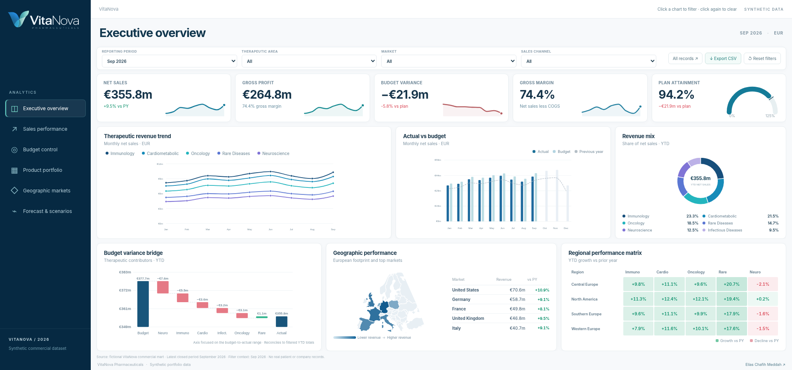
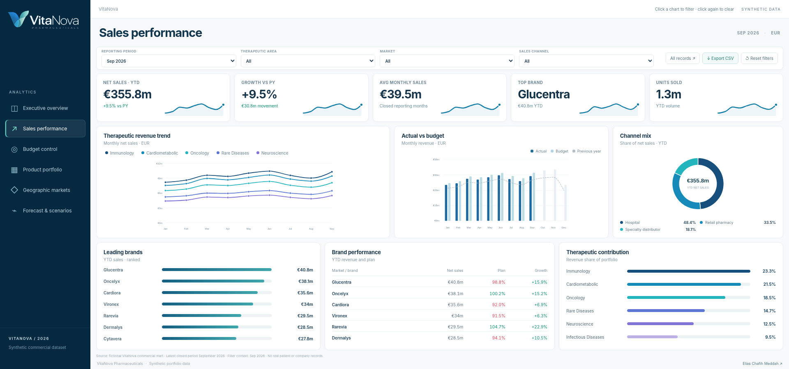
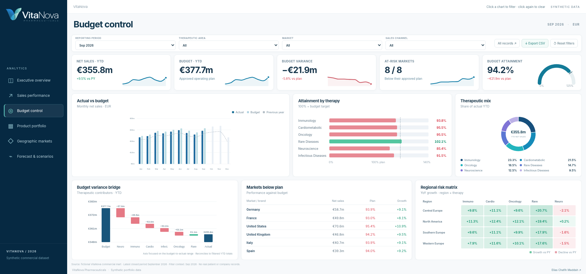
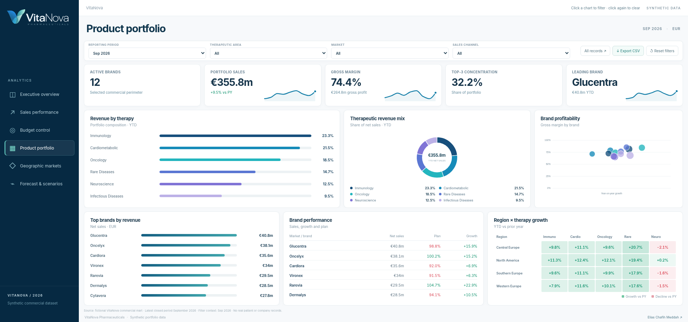
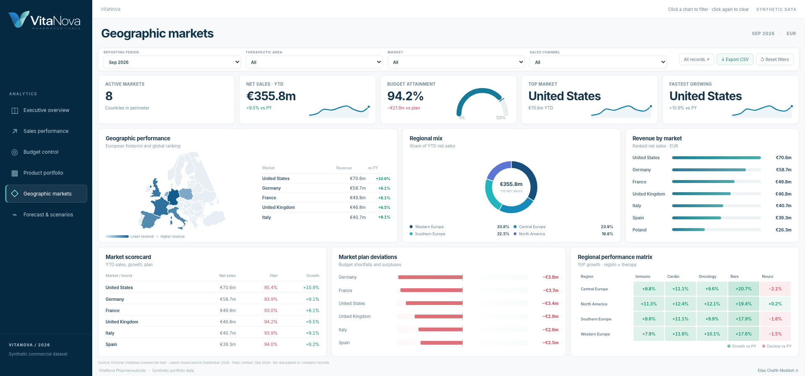
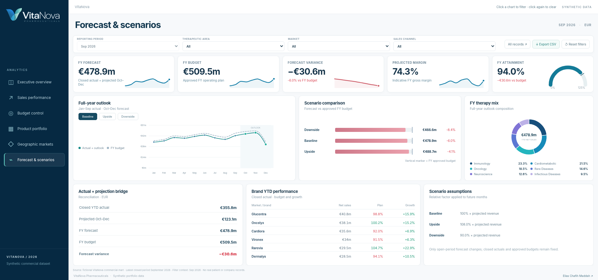

# VitaNova V5.6 — custom visual Power BI + PBIP

El paquete incluye el visual personalizado `.pbiviz` compilado, una séptima página PBIR con los campos DAX enlazados y el proyecto HTML/PBIP original.

Lee `EMPIEZA-AQUI.txt` y `docs/custom_visual_v5_6.md`. La comprobación en Power BI Desktop y el guardado a `.pbix` deben realizarse en Windows.

---

<div align="left"></div>

# VitaNova Pharmaceuticals | Global Commercial Performance Intelligence

**An end-to-end pharmaceutical analytics portfolio case study — from reproducible, synthetic sales data and an auditable Kimball-style data mart to executive KPIs, budget control, brand performance, and scenario-based commercial outlooks.**

> **Independent fictional case study.** VitaNova Pharmaceuticals and all product brands in this project are invented for demonstration. Every sales, budget, forecast and market observation is synthetic. No patient, prescription, company-confidential, or real clinical record is present. The name and visual identity are demonstration-only branding.


### Brand update · October 2026

The logo was updated to the approved minimal **V-shaped blue/teal VitaNova wordmark**. The web sidebar uses `assets/vitanova-logo.png` (light lettering); the report and README use `assets/vitanova-logo-light.png` (navy lettering). The source artwork is preserved at `branding/VitaNova-2026-original-transparent.png`, with a standalone icon and PNG favicon. The approved art is raster; no editable vector original is implied. No changes were made to sales data, measures, dashboard layout or functional controls as part of the brand update.

For Power BI, the six native PBIR pages use the same logo via an **embedded RegisteredResources image visual**. Regenerating the PBIP using `scripts/build_powerbi_pbip.py` automatically reinstates the brand resource.

### Correcciones V4.4 · HTML autónomo compatible con apertura local

La versión web principal, [`index.html`](index.html), es ahora un **único fichero completamente autocontenido**: incorpora el CSS, el logotipo, favicon, dataset sintético, cartografía y código JavaScript. Se abre directamente desde el explorador de Windows con **doble clic**, sin servidor, instalaciones, conexión ni depender de conservar la jerarquía de carpetas. Es posible entregar el HTML por separado. La versión modular para mantener la aplicación está en [`index-modular.html`](index-modular.html), que enlaza los ficheros legibles `assets/` y `data/`.

Al modificar fuentes o regenerar datos, ejecuta `python scripts/build_standalone_html.py` para actualizar el HTML entregable, y `python scripts/build_standalone_html.py --check` para verificarlo. El navegador Chromium ha renderizado **el contenido íntegro del nuevo `index.html`**, sin inyectar assets ni emitir solicitudes de red: seis pestañas, cinco KPI y seis paneles por pestaña; filtros, restablecimiento, exploración de detalle, descarga CSV, escenarios y menú móvil. Por restricciones del entorno de pruebas no se ha realizado una navegación real `file://` desde Windows; el archivo está preparado para ella y no tiene referencias a ficheros externos.

### Correcciones V4.3 · geometría real y líneas suavizadas

Esta entrega incorpora un mapa europeo reconstruido en proyección Lambert equivalente EPSG:3035 (con escala proporcional X/Y) y curvas SVG PCHIP monotónicas, que pasan por todos los datos sin introducir máximos artificiales. En el **PBIP** se configuran los **3 gráficos de líneas nativos** con interpolación suave y los **2 mapas rellenos** con un filtro geográfico exclusivo del visual que evita que EE. UU. desplace el encuadre europeo. `DimMarket[Country]` está categorizado geográficamente. Estas opciones también se reaplican al reconstruir el proyecto, y todos los datos y KPIs globales, incluidos los estadounidenses, se conservan. Más detalles y pruebas en [`docs/visual_fixes_v4_3.md`](docs/visual_fixes_v4_3.md).

## Executive overview

VitaNova's analytics platform addresses a classic commercial-finance problem: business users need a **single definition of actual revenue, approved budget, year-to-date attainment, contribution margin, and full-year forecast**, consistently sliced across products, therapeutic areas, countries and channels.

The technical challenge goes beyond visualizations. The solution models actuals, plan and forecast as **separate facts at identical, explicitly documented grain** and exposes reconciled measures via a shared dimensional model. The browser prototype uses exactly the values shipped in the synthetic CSV marts. A native export action downloads filtered brand-level KPI detail as CSV. The **All records** overlay allows exploring the complete current ranking without squeezing the main dashboard.

### Visual design — V4 · reference-aligned across six workspaces

Every web workspace now has the same **five-KPI / three-main / three-secondary** visual hierarchy, with a premium navy/white design, measured metric sparklines, a single page heading, aligned cards and restrained color semantics. There is no simulated user profile, duplicated banner or decorative slogan. The approved blue/teal V-shaped VitaNova logo is used consistently.

The executive overview uses a therapeutic-area multi-line trend, monthly sales versus budget, a revenue-mix donut, a **reconciled waterfall** of therapeutic budget deviations, a European revenue map with global ranking, and a conditional-formatting **region × therapy** growth matrix. Other workspaces include brand rankings, brand-margin bubbles, channel mix, market budget deviations, scenario comparison and performance scorecards. The visuals share real synthetic marts; no chart values are transcribed from AI-generated pictures.

**Analytical accuracy:** the waterfall starts at filtered YTD budget, incorporates actual-minus-budget by therapeutic area and closes at filtered YTD actual. No unmeasured price/volume/FX drivers are fabricated. The Europe outline is derived from public-domain Natural Earth geography; the U.S. is included in the accompanying market ranking rather than incorrectly plotted on the Europe map.

**Browser QA completed:** after rendering the complete standalone HTML in Chromium with no extra resources, all six pages were checked at **1600×900, 1920×900 and 2560×1230** usable CSS pixels. The checks found no panel intersections or document-level scrolling, no JavaScript errors, and consistent filter/reset behavior. Shorter desktop or mobile viewports use normal page scrolling where necessary rather than shrink the charts. The screenshots below are captured from this executable web project, not generated design images.

**Power BI:** the native `.pbip` also has a 5-KPI/6-visual overview on each of its six pages, using native line, column, donut, bar, waterfall, filled-map, matrix and table visuals. The model has 9 tables, 12 relationships and **65 DAX measures**. PBIR source geometry, field projections and embedded dataset have passed static checks; **opening, refreshing, map-service dependency and visually checking the reports in Power BI Desktop remain unverified**. The native visuals are not pixel-perfect clones of the HTML/SVG design.

### Screenshots captured from the working web application

[](assets/dashboard-overview.png)

| Sales performance | Budget control |
|:---:|:---:|
| [](assets/dashboard-sales.png) | [](assets/dashboard-budget.png) |

| Product portfolio | Geographic markets |
|:---:|:---:|
| [](assets/dashboard-portfolio.png) | [](assets/dashboard-markets.png) |

[](assets/dashboard-forecast.png)

### Explore the dashboard

Download or open [`index.html`](index.html) in a modern browser (Edge/Chrome); it is a **standalone offline document** and does not require the adjacent `assets/` or `data/` folders. No server, build tools, access token, API calls, or third-party chart packages are required. To deploy on GitHub Pages, publish the repository root from `main`.

| Workspace | Decision-making capability |
|---|---|
| Executive overview | Monthly sparkline KPI cards, plan-attainment gauge, therapy trend, sales vs budget, therapy mix, reconciled waterfall, geographic market ranking and regional-growth matrix |
| Sales performance | Monthly revenue, channel mix, year-over-year growth, volume and period KPIs |
| Budget control | MTD / QTD / YTD attainment, absolute and percentage variances, geographical and therapy contribution |
| Product portfolio | Brand rankings, therapy concentration, commercial profitability and full portfolio scorecard |
| Geographic markets | Performance by country, reporting cluster and distribution channel |
| Forecast & scenarios | Actual-to-forecast bridge, FY outlook vs FY budget, baseline / upside / downside |

## Portfolio dataset at a glance

| Attribute | Coverage |
|---|---|
| Organization | Fictional VitaNova Pharmaceuticals |
| Therapeutic areas | **6** |
| Product brands | **12** invented pharmaceutical brands |
| Geography | **8** fictional commercial country markets |
| Distribution | **3** commercial channels |
| Time horizon | January 2025 – December 2026 |
| Closed actuals | Through **September 2026** |
| Actuals | **6,048** monthly grain fact rows |
| Budget | **6,912** monthly grain fact rows |
| Forecast | **3,456** monthly grain fact rows for 2026 |
| Reporting currency | **EUR** for all source records (no FX rates modeled) |

### Controlled reference checks — September 2026

| Metric | Synthetic result |
|---|---:|
| 2026 YTD actual net sales | €355.80m |
| 2026 YTD budget | €377.69m |
| 2026 YTD attainment | 94.21% |
| 2026 YTD budget variance | −€21.88m |
| 2026 FY approved budget | €509.46m |
| 2026 FY baseline outlook | €478.87m |
| 2026 FY outlook / FY budget | 93.99% |

This demonstrates **the difference between YTD attainment and FY outlook attainment**. Comparing January–September actuals against January–December budget would be analytically incorrect.

## Technical architecture

```text
          Deterministic generator / assumptions
                   scripts/generate_data.py
                            │
                            ▼
             Reconciled synthetic source marts
       (Sales Actuals | Commercial Budget | FY Outlook)
                            │
                   Dimensional modeling
                            │
                 ┌──────────┴─────────┐
                 ▼                    ▼
        Power BI PBIP/TMDL       Offline web app
       Native PBIR / DAX / M     HTML / CSS / JS / SVG
                 │                    │
                 └──────────┬─────────┘
                            ▼
          Consistent KPIs and executive analytics
                            │
                            ▼
          SQL quality checks / Python assertions
```

### Dimensional semantic model

- `FactSales`: **month × brand × country × sales channel**; actual financial amount, units, revenue adjustments and cost.
- `FactBudget`: **month × brand × country × sales channel**; original approved plan metrics.
- `FactForecast`: **month × brand × country × sales channel** for 2026; closed actualized and future projected components are explicitly labeled.
- `DimDate`: daily conformed calendar, 2025–2026; the facts join on the *first day of each month*.
- `DimProduct`: brand, therapeutic area, indicative list price and target gross margin.
- `DimMarket`: country, geographic reporting cluster and reporting currency.
- `DimChannel`: channel taxonomy.
- `DimScenario`: disconnected illustrative sensitivity parameters.

**Relationships:** each dimension filters all three financial facts through single-direction **1 → many** relationships. No fact-to-fact relationship; no ambiguous bidirectional propagation. Budget is neither merged into nor allocated twice over actuals.

See [architecture](docs/architecture.md), [metric methodology](docs/metrics.md), [data dictionary](docs/data_dictionary.md) and [Power BI setup](powerbi/README.md).

## Key design decisions

1. **Comparable budget perimeter.** For any YTD, QTD or MTD view, actual and budget use the same month range and dimension selections.
2. **Weighted measures.** Attainment and margin are evaluated as ratios of aggregated amounts, not averages of row-level ratios.
3. **Explicit close date.** The last closed period is September 2026; future actuals are not fabricated.
4. **Scenario isolation.** Upside / downside sensitivity affects October–December *projections only*; closed actuals and approved budget stay fixed.
5. **Conformed slicers.** Market, channel, product and date filters propagate consistently through all three fact tables.
6. **No implied patient counts.** Product units are illustrative commercial packs; they do not represent individual patients or clinical outcomes.

## Reproduce / validate

Standard Python 3.10+ is enough; the generator and validator use only its standard library:

```bash
python scripts/generate_data.py
python scripts/validate_data.py
```

The output includes the exact CSVs, plus the browser's lightweight [`dashboard-data.js`](data/dashboard-data.js). Data generation is deterministic, so the same source code produces the same results across rebuilds.

The validation routine checks expected row counts, uniqueness at fact grain, dimension foreign keys, source accounting reconciliation, actual-to-budget coverage, forecasting classifications, closed-month ties between sales and forecast, and key KPIs. The V4 layout checks used the modular assets; the V4.4 regression test additionally loads the exact standalone index.html source into Chromium with no external requests. Visual screenshots were captured from the working application, and a separate Power BI Desktop render check is still required. It requires Chromium and Playwright installed locally.

### Power BI artifacts and verification scope

**Native Power BI project:** [`powerbi/VitaNova.pbip`](powerbi/VitaNova.pbip). This contains editable `.Report` and `.SemanticModel` folders, six native report pages and a centrally managed TMDL model with 65 DAX measures. The data import is self-contained: the eight source marts are compressed into Power Query M, so no local file path is needed. Recreate with `python scripts/build_powerbi_pbip.py`; run `python scripts/validate_powerbi_pbip.py` for static checks. Additional, human-readable DAX and M examples are available in [`powerbi/DAX/Measures.dax`](powerbi/DAX/Measures.dax) and [`powerbi/PowerQuery/LoadCsvExample.pq`](powerbi/PowerQuery/LoadCsvExample.pq).

**Important:** the generated native `.pbip` passes file-structure, in-canvas geometry, source embedding, relationship and field-binding checks. It has **not been opened, refreshed or visually verified in Microsoft Power BI Desktop** and is not a compiled `.pbix`. A custom `.pbiviz` is not necessary because this implementation uses native visuals. The offline HTML/JS dashboard is a separate implementation, not a published report or live Power BI connection.

## Technology stack

Python · SQL quality checks · Kimball dimensional modeling · Power BI semantic-model design · DAX time intelligence · Power Query M · JavaScript · SVG analytics · CSS responsive UI · Git / GitHub Pages

## Repository structure

```text
├── index.html                  # Standalone offline dashboard (single-file HTML)
├── index-modular.html          # Editable web entry point loading assets/data
├── assets/                     # Brand identity, application code and styling
├── data/                       # Conformed dimensions, actual / budget / forecast marts
├── scripts/                    # Deterministic generation, PBIP build + validation
├── powerbi/                    # Native VitaNova.pbip + TMDL/PBIR + DAX/M references
├── sql/                        # SQL-based quality controls
├── docs/                       # Analytics methodology, architecture, dictionary
└── tests/                      # Reproducibility smoke tests
```

---

### Author

**Elías Chafih Meddah** · Senior BI & Analytics Engineer  
[GitHub](https://github.com/eliasgitch)

<sub>VitaNova is a completely fictional commercial analytics simulation. Numbers and brand names are for software-engineering demonstration only.</sub>

## Filtros cruzados (V5.0)

La demo web tiene selecciones interactivas sobre barras, donut, mapa, matrices, leyendas y rankings. Todas ellas recalculan el resto de figuras. Las selecciones pueden combinarse, persisten entre páginas y se pueden borrar con **Clear selection**. Consulta [docs/cross_filtering_v5.md](docs/cross_filtering_v5.md). El proyecto PBIP utiliza las interacciones nativas de Power BI.


## Power BI Desktop 2026 y visual personalizado (V5.1)

La entrega V5.0 registró un error de carga `Microsoft.MashupEngine; Depth limit exceeded` provocado probablemente por expresiones M de concatenación muy profundas. El proyecto V5.1 sustituye dichas expresiones por listas planas `Text.Combine` y conserva íntegramente los ocho marts CSV, 9 tablas, 12 relaciones, 65 medidas DAX y 109 visuales. Pendiente comprobar la apertura real en Desktop.

Para reproducir fielmente la simulación web dentro de Power BI, `powerbi/custom-visual/VitaNovaWebReplica/` contiene el código fuente de un visual SDK con HTML/CSS/JS/SVG y datos sintéticos embebidos. Es una replica autónoma y aún no está conectada a los `DataView` del modelo; se debe compilar con `npx pbiviz package` y probar en Power BI. Se mantienen los visuales nativos como implementación semántica independiente.

Consulta `powerbi/README.md` para las instrucciones y limitaciones de la V5.1.
